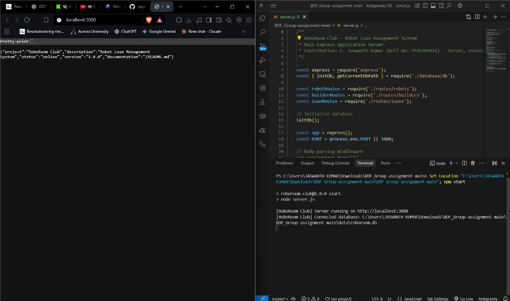
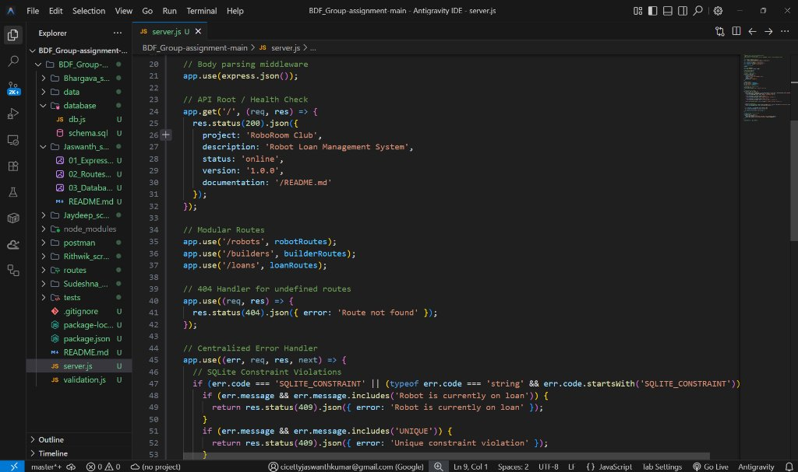
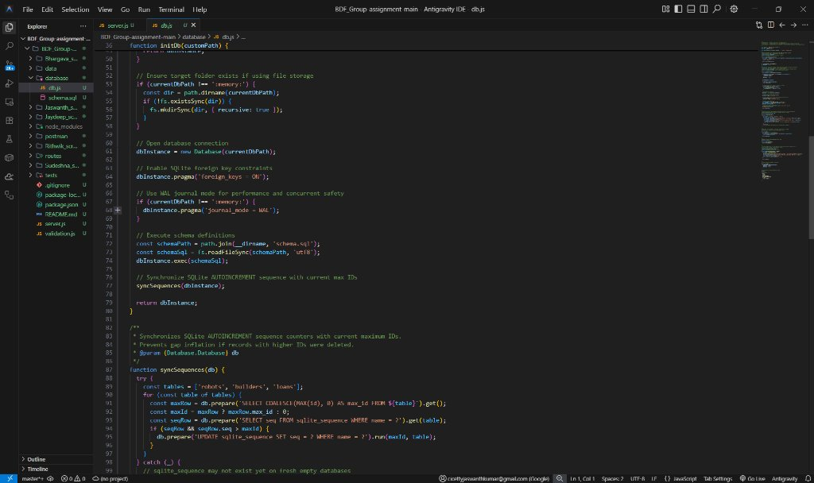
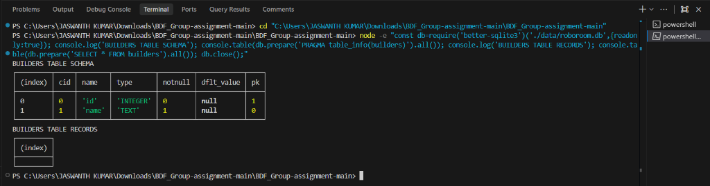
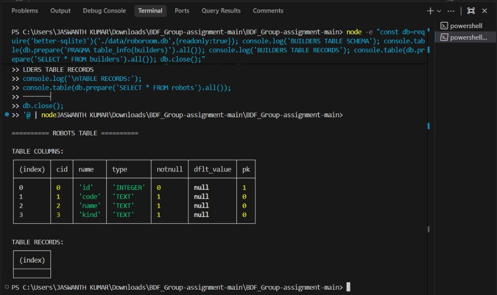
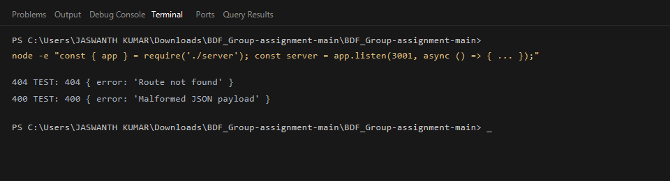
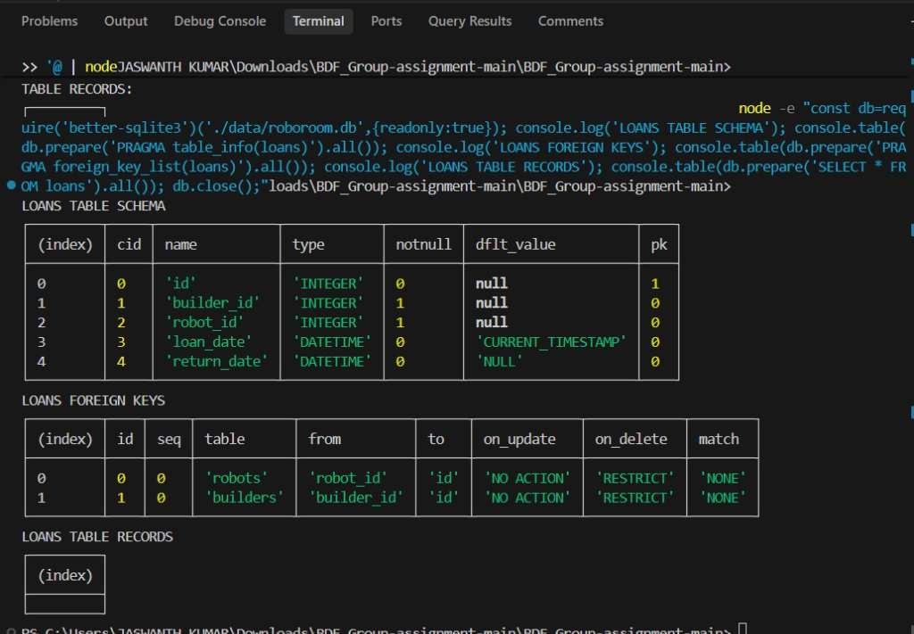

# Screenshot Guide – C. Jaswanth Kumar

**Team Member:** C. Jaswanth Kumar  
**Roll Number:** 252U1R9026  
**Assigned Responsibility:** Server, routes and database

---

## Assigned Responsibilities
Jaswanth handles the foundational architecture:
- Express server configuration, middleware, and route mounting in `server.js`.
- SQLite database connection, schema setup (`database/schema.sql`), foreign key enforcement, and initialization in `database/db.js`.
- HTTP status codes and centralized error handling middleware.

---

## Screenshot Checklist

Capture the following execution screenshots and place them inside `Jaswanth_screenshot/`:

| Filename | Action / View | Description / Expected Result | Status |
| :--- | :--- | :--- | :---: |
| `01_Express_Server_Running.png` | Terminal running `npm start` | Console log showing server running on `http://localhost:3000`. | **Captured** |
| `02_Routes_Configuration.png` | Code editor / IDE view | View of `server.js` showing modular routes mounted (`/robots`, `/builders`, `/loans`). | **Captured** |
| `03_Database_Connection.png` | Code editor / IDE view | View of `database/db.js` showing `better-sqlite3` initialization and `PRAGMA foreign_keys = ON`. | **Captured** |
| `04_Builders_Table.png` | SQLite CLI / DB Browser | View showing schema and records of `builders` table (`id`, `name`). | **Captured** |
| `05_Robots_Table.png` | SQLite CLI / DB Browser | View showing schema and records of `robots` table (`id`, `code`, `name`, `kind`). | **Captured** |
| `06_Additional_Verification.png` | Terminal / API client view | Verification of centralized error handling, SQLite constraint enforcement (409 Conflict), or malformed JSON handling (400 Bad Request). | **Captured** |
| `07_Loans_Table.png` | SQLite CLI / DB Browser | View showing schema and records of `loans` table with foreign key relationships. | **Captured** |

---

## Visual Gallery & Verification

### 01. Express Server Running (`npm start`)
Console output confirming server running on `http://localhost:3000` and connected to `data/roboroom.db`.

### 02. Routes Configuration (`server.js`)
Code view of `server.js` displaying modular route mounting (`/robots`, `/builders`, `/loans`), health check, and 404 handler.

### 03. Database Connection & Setup (`database/db.js`)
Code view of `database/db.js` showing `better-sqlite3` connection, `PRAGMA foreign_keys = ON`, `WAL` journal mode, and schema execution.

### 04. Builders Table Schema & Records
Schema and records of the `builders` table showing `id` (INTEGER PRIMARY KEY AUTOINCREMENT) and `name` (TEXT NOT NULL).

### 05. Robots Table Schema & Records
Schema and records of the `robots` table showing `id` (INTEGER PRIMARY KEY AUTOINCREMENT), `code` (TEXT UNIQUE NOT NULL), `name` (TEXT NOT NULL), and `kind` (TEXT NOT NULL).

### 06. Additional Verification (Error Middleware & Constraints)
Terminal response showing centralized error handling: unknown route returning HTTP 404 Not Found (`Route not found`), and malformed JSON payload rejection returning HTTP 400 Bad Request (`Malformed JSON payload`).

### 07. Loans Table Schema, Foreign Keys & Records
Schema and records of the `loans` table showing foreign key references to `builders(id)` and `robots(id)` with `ON DELETE RESTRICT` constraints.

---

## Instructions for Submission
1. Start the server (`npm start`) and inspect the database via SQLite CLI or DB Browser for SQLite.
2. Save clear screenshots with the exact filenames indicated above into `Jaswanth_screenshot/`.
3. Commit all captured images to `Jaswanth_screenshot/`.

