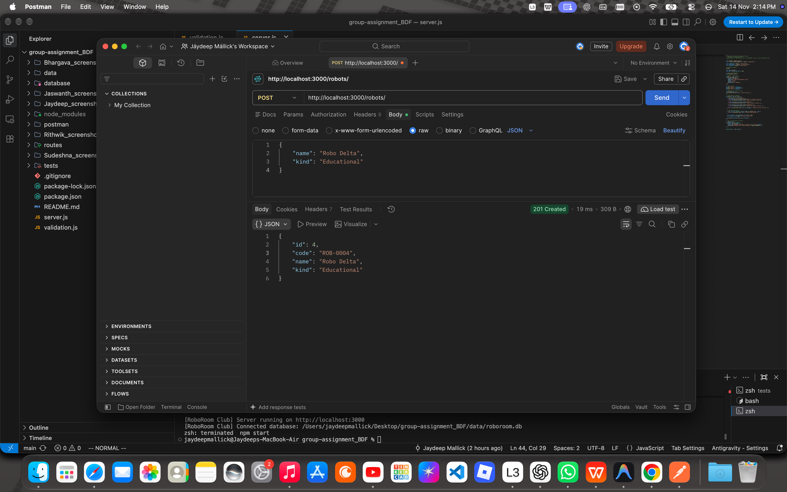
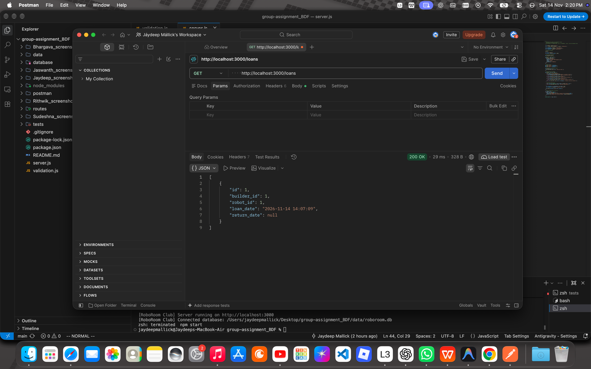
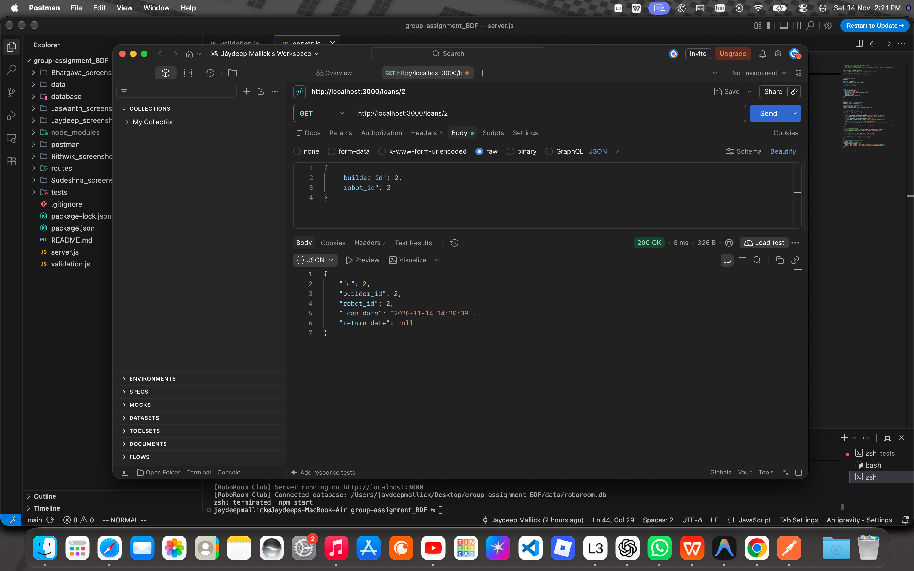
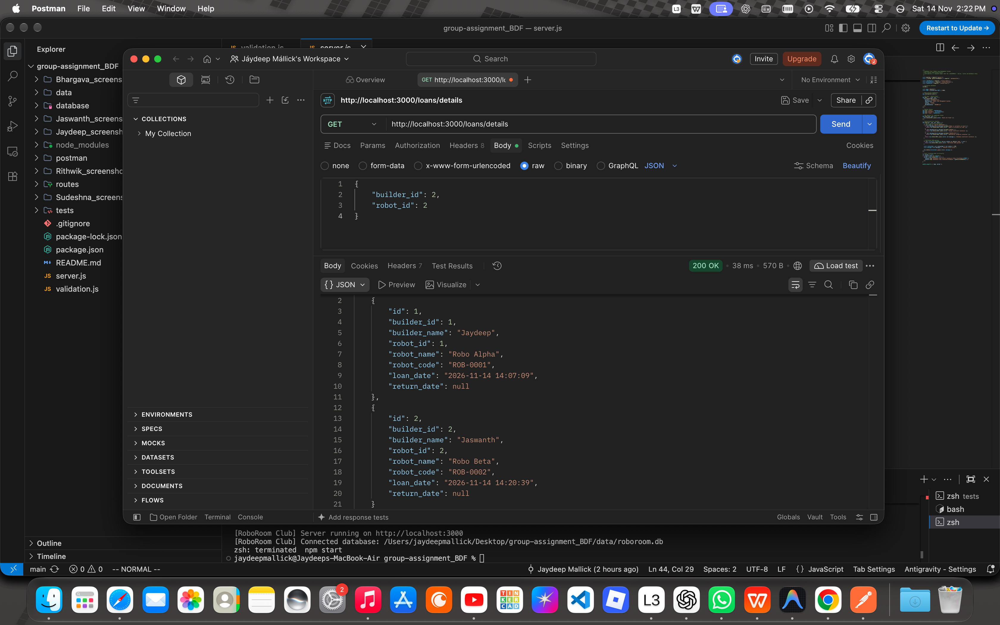
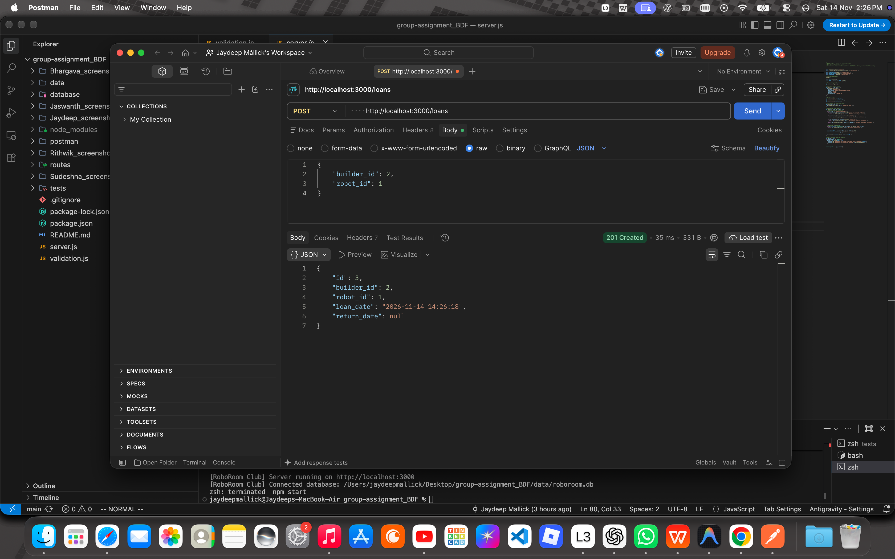
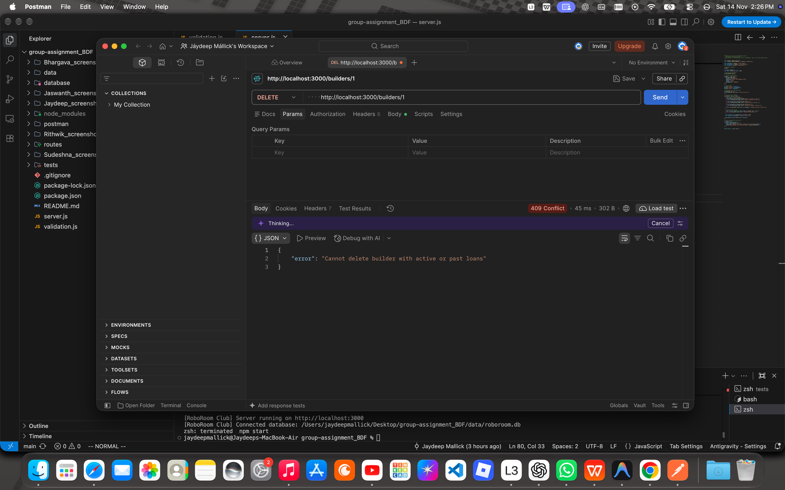

# Execution Screenshots – Jaydeep Mallick

**Team Member:** Jaydeep Mallick  
**Roll Number:** 252U1R9047  
**Assigned Responsibility:** REST Endpoints for builders, robots, and loans, including the mandatory SQL JOIN endpoint

---

## Assigned Responsibilities
Jaydeep is responsible for implementing and testing the REST API endpoints across all three system resources:
- **Robot CRUD Operations:** `GET /robots`, `GET /robots/:id`, `POST /robots`, `PUT /robots/:id`, and `DELETE /robots/:id`.
- **Builder CRUD Operations:** `GET /builders`, `GET /builders/:id`, `POST /builders`, `PUT /builders/:id`, and `DELETE /builders/:id`.
- **Loan Operations:** `GET /loans`, `POST /loans`, `GET /loans/:id`, and `POST /loans/:id/return`.
- **Mandatory SQL JOIN Endpoint:** `GET /loans/details` returning builder name, robot name, and robot code.
- **Referential Integrity & Error Handling:** Preventing deletion of builders or robots with active/historical loans.

---

## Complete Screenshot Catalog & Verification

| # | Filename | Method & Endpoint | HTTP Status | Description / Captured Behavior |
|---|:---|:---|:---:|:---|
| 01 | `01_GET_All_Robots.png` | `GET /robots` | `200 OK` | Retrieves all registered competition robots in array format. |
| 02 | `02_GET_Robot_By_ID.png` | `GET /robots/1` | `200 OK` | Retrieves single robot by ID (`Robo Alpha`, `ROB-0001`). |
| 03 | `03_POST_Add_Robot.png` | `POST /robots` | `201 Created` | Creates a new robot (`Robo Delta`) with sequential code `ROB-0004`. |
| 04 | `04_PUT_Update_Robot.png` | `PUT /robots/4` | `200 OK` | Updates robot name to `Robo Delta Updated`; code remains immutable `ROB-0004`. |
| 05 | `05_DELETE_Robot.png` | `DELETE /robots/4` | `204 No Content` | Successfully deletes unloaned robot (`id: 4`). |
| 06 | `06_GET_All_Builders.png` | `GET /builders` | `200 OK` | Retrieves list of registered builders (`Jaydeep`, `Jaswanth`). |
| 07 | `07_GET_Builder_By_ID.png` | `GET /builders/1` | `200 OK` | Retrieves single builder by ID (`Jaydeep`). |
| 08 | `08_POST_Add_Builder.png` | `POST /builders` | `201 Created` | Creates a new builder (`Demo Builder`, `id: 3`). |
| 09 | `09_PUT_Update_Builder.png` | `PUT /builders/3` | `200 OK` | Updates builder name to `Demo Builder Updated`. |
| 10 | `10_DELETE_Builder.png` | `DELETE /builders/3` | `204 No Content` | Successfully deletes builder without loan records (`id: 3`). |
| 11 | `11_GET_All_Loans.png` | `GET /loans` | `200 OK` | Retrieves all loan contracts (`id: 1, return_date: null`). |
| 12 | `12_POST_Create_Loan.png` | `POST /loans` | `201 Created` | Creates an active loan (`id: 2`) for Jaswanth borrowing Robo Beta. |
| 13 | `13_GET_Loan_By_ID.png` | `GET /loans/2` | `200 OK` | Retrieves specific loan details by ID. |
| 14 | `14_GET_Loans_Details_JOIN.png` | `GET /loans/details` | `200 OK` | **Mandatory JOIN Endpoint:** Combines `loans`, `builders`, and `robots` tables. |
| 15 | `15_POST_Return_Loan.png` | `POST /loans/1/return` | `200 OK` | Returns loan 1, setting `return_date` timestamp. |
| 16 | `16_POST_Reloan_After_Return.png` | `POST /loans` | `201 Created` | Verifies robot can be re-loaned to another builder once returned. |
| 17 | `17_DELETE_Builder_Conflict_Integrity.png` | `DELETE /builders/1` | `409 Conflict` | Referential integrity: Prevents deletion of builder with loans. |

---

## Visual Gallery

### 1. Robot CRUD Operations

#### 01. GET All Robots (`GET /robots` – 200 OK)

#### 02. GET Robot by ID (`GET /robots/1` – 200 OK)

#### 03. POST Add Robot (`POST /robots` – 201 Created)

#### 04. PUT Update Robot (`PUT /robots/4` – 200 OK)

#### 05. DELETE Robot (`DELETE /robots/4` – 204 No Content)

---

### 2. Builder CRUD Operations

#### 06. GET All Builders (`GET /builders` – 200 OK)

#### 07. GET Builder by ID (`GET /builders/1` – 200 OK)

#### 08. POST Add Builder (`POST /builders` – 201 Created)

#### 09. PUT Update Builder (`PUT /builders/3` – 200 OK)

#### 10. DELETE Builder (`DELETE /builders/3` – 204 No Content)

---

### 3. Loan Operations & Mandatory SQL JOIN

#### 11. GET All Loans (`GET /loans` – 200 OK)

#### 12. POST Create Loan (`POST /loans` – 201 Created)

#### 13. GET Loan by ID (`GET /loans/2` – 200 OK)

#### 14. GET Loans Details – Mandatory SQL JOIN (`GET /loans/details` – 200 OK)

#### 15. POST Return Loan (`POST /loans/1/return` – 200 OK)

#### 16. POST Re-loan Robot After Return (`POST /loans` – 201 Created)

#### 17. DELETE Builder Referential Integrity Conflict (`DELETE /builders/1` – 409 Conflict)

